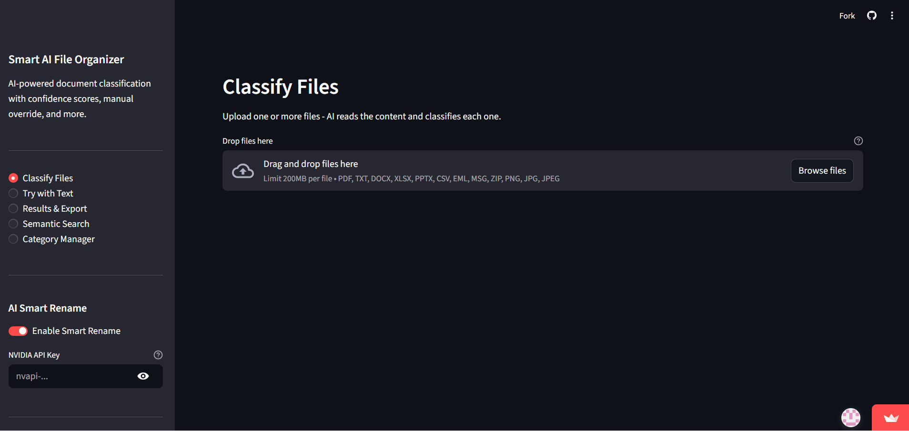

# Smart AI File Organizer

<p align="center">
  
  
  
  
  <a href="https://pypi.org/project/smart-ai-file-organizer/">
    
  </a>
  <a href="https://smart-ai-file-organizer.streamlit.app">
    
  </a>
</p>

<p align="center">
  <strong>AI-powered file organization for messy local folders.</strong><br>
  Classify, deduplicate, rename, and search documents by what they contain, not what they are called.<br>
  Available via CLI, Desktop GUI, and Streamlit web app.
</p>

<p align="center">
  <a href="#quick-start">Quick Start</a> &middot;
  <a href="#interfaces">Interfaces</a> &middot;
  <a href="#demo">Demo</a> &middot;
  <a href="#usage">Usage</a> &middot;
  <a href="#accuracy">Accuracy</a> &middot;
  <a href="docs/ROADMAP.md">Roadmap</a>
</p>

---

## Demo



---

## Why Smart AI File Organizer?

Filenames are unreliable: `scan_001.pdf`, `final_final.docx`, duplicate downloads, and screenshots end up cluttering your folders. 

Smart AI File Organizer inspects the text inside each document and structures your files safely:

```text
Before: Downloads/                 After: Downloads/
|-- scan_001.pdf                   |-- Finance/
|-- final_final.docx               |   `-- budget_march.xlsx
|-- notes.txt                      |-- Resume/
|-- report-copy.pdf                |   `-- final_final.docx
|-- IMG_2044.jpg                   |-- Research/
`-- budget_march.xlsx              |   `-- report-copy.pdf
                                   |-- Personal/
                                   |   `-- IMG_2044.jpg
                                   |-- Other/
                                   |   `-- notes.txt
                                   `-- _Duplicates/
```

- **Content-Aware Classification:** Categorizes files using transformer embeddings (`sentence-transformers`) or a fast offline TF-IDF model.
- **Duplicate Quarantine:** Detects duplicate files by content hash and moves them to `_Duplicates/`.
- **Safety First:** Preview any run with `--dry-run`. Live runs mandate confirmation (`--yes` for automation) and log structured history to `.smart-organizer/history.jsonl`.
- **1-Click Undo:** Reverts moves safely, verifying content hashes so user-modified files are never overwritten.
- **Multi-Format Support:** PDF, DOCX, TXT, XLSX, PPTX, CSV, EML, MSG, ZIP, PNG, JPG (with OCR fallback for scanned images and PDFs).
- **Semantic Search:** Find documents by meaning instead of exact keywords via a fast local JSON search index.

---

## Quick Start

Install directly from [PyPI](https://pypi.org/project/smart-ai-file-organizer/):

```bash
pip install smart-ai-file-organizer
```

Install with optional extras when needed:

```bash
pip install "smart-ai-file-organizer[ai,web]"   # Transformer model + Streamlit app
pip install "smart-ai-file-organizer[ocr]"      # OCR for scanned PDFs & images (Tesseract)
pip install "smart-ai-file-organizer[rename]"   # AI Smart Rename (NVIDIA API)
pip install "smart-ai-file-organizer[all]"      # All extras
```

### Install from Source

```bash
git clone https://github.com/sarawagh27/smart-ai-file-organizer.git
cd smart-ai-file-organizer
python -m venv .venv
source .venv/bin/activate        # Windows: .venv\Scripts\activate
pip install -e ".[dev]"
```

---

## Interfaces

| Interface | Best For | Command |
| :--- | :--- | :--- |
| **CLI** | Fast automation and scheduled cron jobs | `smart-organizer ~/Downloads` |
| **Desktop GUI** | Interactive review and category customization | `smart-organizer-gui` |
| **Streamlit** | Visual browser-based uploads and search | `streamlit run streamlit_app.py` |
| **Watch Mode** | Continuous background directory monitoring | `smart-organizer-watch ~/Downloads` |

---

## Usage

### Command Line

```bash
# 1. Preview changes without moving any files (completely offline)
smart-organizer ~/Downloads --dry-run

# 2. Live run (prompts for confirmation)
smart-organizer ~/Downloads

# 3. Live run without prompt (for scripts and automation)
smart-organizer ~/Downloads --yes

# 4. Include subdirectories
smart-organizer ~/Downloads --recursive

# 5. Undo the last run
smart-organizer ~/Downloads --undo

# 6. Enable AI Smart Rename
smart-organizer ~/Downloads --smart-rename
```

---

## Accuracy

We evaluate classification accuracy on 56 held-out documents across 8 categories ([`scripts/evaluate_classifier.py`](scripts/evaluate_classifier.py)):

| Model | Setup | Accuracy |
| :--- | :--- | :--- |
| **TF-IDF + Naive Bayes** | v0.1.0 defaults (8 samples/category) | 80% (45/56) |
| **TF-IDF + Naive Bayes** | v0.2.0 defaults (16 samples/category) | **95% (53/56)** |
| **Transformer** (`sentence-transformers`) | Offline embeddings + user corrections | Run with `--transformer` |

---

## Configuration & Customization

Copy the template to create your local config:

```bash
cp config.example.json config.json      # Windows: copy config.example.json config.json
```

Add your custom categories or training keywords in `config.json` (git-ignored to protect private rules):

```json
{
  "categories": ["Finance", "Resume", "Research", "MyCategory"],
  "training_data": {
    "MyCategory": ["project specs quarterly roadmaps meeting minutes"]
  }
}
```

### AI Smart Rename Setup

To generate descriptive filenames (e.g. `scan0023.pdf` &rarr; `Invoice_Amazon_Mar2024.pdf`):
1. Get a free API key from [NVIDIA Build](https://build.nvidia.com/models).
2. Set `export NVIDIA_API_KEY="nvapi-..."` (or add to `config.json` under `smart_rename.api_key`).
3. Run `smart-organizer ~/Downloads --smart-rename`.

---

## Development & Testing

```bash
# Run linter
python -m ruff check .

# Run test suite (112 tests, fast offline mode)
python -m pytest -q

# Run classifier benchmark
python scripts/evaluate_classifier.py
```

Documentation & guides:
- [ARCHITECTURE.md](docs/ARCHITECTURE.md) &mdash; Pipeline design, safety model, and service layers.
- [CHANGELOG.md](docs/CHANGELOG.md) &mdash; Detailed version history.
- [ROADMAP.md](docs/ROADMAP.md) &mdash; Upcoming features and milestones.

---

## License

[MIT](LICENSE) &copy; Sara Wagh
